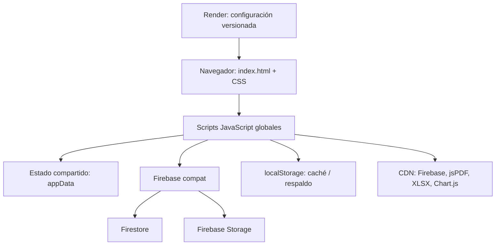

# Auditoría técnica del sistema CIAM

**Fecha de revisión:** 2026-10-12

**Alcance:** revisión estática del repositorio local en `main`, commit `c4ec58d`. El árbol estaba limpio y `main` coincidía con `origin/main` al iniciar esta revisión.
**Resultado:** este documento es el único archivo añadido. No se modificaron código, configuración, reglas, datos, dependencias ni despliegues.

> Esta revisión describe lo que puede demostrarse desde el código y los documentos versionados. No equivale a una prueba de funcionamiento en producción, una auditoría de la consola Firebase ni una certificación de seguridad.

## 1. Resumen ejecutivo

CIAM es una aplicación web cliente, principalmente estática, para generar documentos comerciales, gestionar productos e inventario, registrar ventas y gastos, revisar movimientos y mostrar estadísticas. La interfaz y la lógica están escritas en JavaScript clásico y comparten estado global. Firebase compat se usa para Firestore y Storage; `localStorage` actúa como caché y, bajo ciertos fallos, como respaldo local.

Los aspectos prioritarios identificados en código o documentación son:

1. **Autorización:** el login y los roles son lógica del navegador, y el repositorio documenta reglas Firestore que permiten lectura/escritura sin autenticación. No se pudo comprobar si esas reglas están desplegadas actualmente. Si las reglas permisivas descritas se usan en el proyecto conectado, los controles de la interfaz no protegen los datos.
2. **Consistencia y confirmación de guardado:** hay rutas de respaldo local cuando Firestore falla; varias llamadas no distinguen claramente un guardado local de uno remoto. Es necesario definir y probar qué significa “guardado” para el usuario y para cada dispositivo.
3. **Concurrencia y forma de almacenamiento:** historial, gastos y otros conjuntos se guardan como arreglos dentro de un documento central. Las escrituras que leen-modifican-reemplazan arreglos pueden competir entre pestañas/dispositivos y el documento central puede crecer con el uso.
4. **Datos mostrados en HTML:** hay interpolación de valores almacenados en `innerHTML` en listados. Conviene probar valores con marcado y adoptar renderizado seguro donde corresponda.
5. **Calidad y pruebas:** no se encontró suite automatizada ni configuración de build/dependencias del proyecto. La sintaxis de los 17 archivos JavaScript pasó `node --check`; eso no prueba lógica, integración ni persistencia.

No se hicieron pruebas con Firestore/Storage reales, cuentas de usuario, datos de producción, navegador ni mediciones de carga.

## 2. Objetivo y alcance

Se revisaron la aplicación, sus módulos JavaScript, el HTML/CSS, la configuración de Firebase/Render y la documentación de instalación/sincronización disponible en el repositorio. Se trazaron las áreas centrales: autenticación, separación por empresa, carga y persistencia, operaciones comerciales, inventario, movimientos, gastos, estadísticas y exportación.

Se excluyeron deliberadamente acciones que alteren el sistema: cambios de código o configuración, cambios en reglas Firebase, migraciones, acceso a datos productivos, despliegues y experimentos destructivos. Las recomendaciones de este informe no se han aplicado.

## 3. Método y nivel de evidencia

- **Revisión estática:** lectura de código y documentación versionados; búsquedas de referencias y llamadas entre módulos.
- **Comprobación local:** `node --check` completó sin errores para los 17 archivos `js/*.js`.
- **No verificado en ejecución:** autenticación real, permisos desplegados, escritura/lectura en Firestore, sincronización multiusuario, renderizado con datos reales, rendimiento, comportamiento de PDF/Excel en navegadores o compatibilidad de dispositivos.
- **Clasificación:** “observado” significa que el comportamiento está presente en el código/documentación; “riesgo” significa que su impacto depende de despliegue, datos o condiciones de ejecución que no se pudieron verificar.

## 4. Inventario del repositorio

La raíz contiene `index.html`, `css/styles.css`, 17 módulos en `js/`, documentación de Firebase/sincronización, `firebase.json`, `.firebaserc`, `render.yaml` y `README.md`. No se encontró `package.json`, archivo de lock, configuración de bundler ni manifiesto de pruebas automatizadas.

La página carga scripts clásicos desde el HTML. Entre las bibliotecas externas observadas están Firebase 9.22.0 compat, jsPDF 2.5.1, XLSX 0.18.5 y Chart.js 4.4.0. No se observa un proceso de compilación: las dependencias se resuelven desde CDN.

## 5. Arquitectura y despliegue

La estructura es una SPA ligera con secciones ocultadas/mostradas en la misma página; no se identificó router o framework. Las funciones se exponen al objeto `window` y las acciones del HTML llaman funciones directamente. Firestore y Storage se inicializan en `js/firebase-config.js`; la configuración de hosting se describe mediante los archivos de Firebase y Render. La existencia de configuración local no prueba por sí sola qué commit está desplegado ni qué servicios están activos.

## 6. Mapa funcional de módulos

| Área | Archivos principales | Responsabilidad observada |
|---|---|---|
| Inicio y utilidades | `index.html`, `js/app.js`, `js/utils.js` | Navegación por secciones, inicialización, actualización de interfaz, copia/restauración JSON. |
| Estado y persistencia | `js/data.js`, `js/firebase-config.js` | Estado global, carga/guardado, caché local, sincronización Firestore, chunks de productos e imágenes. |
| Login y empresa | `js/auth.js`, `js/multicompany.js` | Validación de acceso en cliente, selección/detección de empresa y cambio de datos en memoria. |
| Catálogo y clientes | `js/products.js`, `js/clients.js`, `js/sellers.js`, `js/company.js` | Altas/edición, selección/autocompletado, configuración y ciudades/inventarios. |
| Documentos | `js/quotes.js`, `js/pdf.js` | Edición de ítems, cálculos y generación de cotización, nota de venta y nota de entrega PDF. |
| Movimientos y gastos | `js/sales.js`, `js/gastos.js`, `js/history.js` | Listados filtrados, historial, registro/anulación de ventas y gastos. |
| Inventario | `js/inventory.js` | Consulta/edición de existencias, acciones sobre productos y exportación de inventario. |
| Analítica | `js/estadisticas.js` | Filtros y agregaciones para tarjetas y gráficos Chart.js. |

El diagrama representa relaciones observadas, no límites de seguridad ni de servicio. No se identificó un backend propio que aplique autorización o reglas de negocio fuera del navegador y Firebase.

## 7. Inicio de sesión, roles y aislamiento entre empresas

`js/auth.js` implementa la interfaz de acceso. `js/multicompany.js` detecta empresa con credenciales disponibles al cliente; `js/utils.js` oculta o muestra acciones según `appData.userRole`. El alta de vendedores guarda el campo `password` junto con otros datos del vendedor en el objeto de aplicación (`js/sellers.js`).

**Hallazgo observado:** estas verificaciones son ejecutadas en JavaScript cliente y, por sí solas, no constituyen autorización del lado del servidor. La constante de credencial administrativa predeterminada está definida en `js/multicompany.js`. No se encontró en el inventario una integración con Firebase Authentication que vincule las operaciones a una identidad autenticada.

**Riesgo condicionado:** si una persona puede leer la base central según las reglas efectivas, podría obtener los datos almacenados independientemente de la UI o su rol aparente. El alcance real depende de las reglas desplegadas, la configuración del proyecto y las restricciones adicionales del proveedor, aspectos que no se verificaron.

## 8. Modelo de datos y fuentes de verdad

El estado de trabajo principal reside en el objeto global `appData` (`js/data.js`). La estructura incluye, entre otros, empresa, inventarios, clientes, vendedores, productos, historial PDF, gastos, términos y contadores.

En el código revisado:

- Los gastos e historial comercial se guardan como arreglos en el documento central de datos.
- Los productos pueden guardarse en chunks, con un indicador `productsStorage`.
- Las imágenes de productos se cargan a Storage; el cliente también conserva caché local de imágenes.
- Los datos de empresa adicional usan rutas de compañía; el código contiene rutas distintas para productos y documento central.
- El historial contiene referencias/datos del documento y los gastos incluyen campos propios, incluidos identificadores locales.

La organización como arreglos facilita el consumo desde el cliente, pero el tamaño y la contención de escrituras aumentan con el volumen. El repositorio no aporta mediciones de tamaño actual ni límites efectivos alcanzados.

## 9. Carga, guardado y sincronización

`loadData()` copia los resultados de `loadAllData()` a `appData` (`js/data.js`). `loadAllData()` intenta leer Firestore, hidrata productos desde chunks, combina datos locales en algunos casos y activa una resincronización pendiente (`js/firebase-config.js`). `saveAllData()` prepara datos para persistencia y escribe Firestore; ante fallos puede guardar en `localStorage`.

**Hallazgo observado:** un `true` devuelto por una ruta de guardado puede significar que la copia local se escribió, no necesariamente que Firestore confirmó el cambio. Algunos flujos sí comprueban el resultado, pero no todos los llamadores siguen el mismo contrato. Por ello, no debe interpretarse el retorno global como confirmación remota sin revisar la ruta concreta.

**Riesgo observado:** fusionar caché y nube puede ser necesario para recuperar datos creados sin conexión, pero requiere reglas explícitas de precedencia, borrado, conflicto y confirmación. El código usa estrategias diferentes para historial, gastos y clientes. Un dato local antiguo o una sincronización pendiente puede generar divergencia entre dispositivos.

**Concurrencia:** el documento central se actualiza dentro de transacción en ciertas rutas, pero varios conjuntos se representan como arreglos completos. La integridad frente a ediciones simultáneas depende de cómo se realice cada lectura/modificación/escritura y de la transacción concreta; no se hizo una prueba con dos clientes concurrentes.

## 10. Productos, stock e inventarios

Los productos tienen identificador local, descripción, código, precio, costo, stock por inventario, fecha de registro e imagen (`js/products.js`). El guardado valida descripción y unicidad del código en el conjunto cargado en el cliente, actualiza el estado y llama `saveData()`. La edición y borrado de productos/inventario se distribuyen entre `js/products.js`, `js/inventory.js` y `js/company.js`.

La consulta, filtros por ciudad y exportación PDF/Excel se ejecutan en cliente. La validación de código duplicado ocurre contra el estado descargado: sin una restricción equivalente en la escritura remota, dos ediciones simultáneas podrían validar el mismo código. No se confirmó que esto haya ocurrido.

Las ventas pueden descontar stock al crear el documento y las anulaciones/restauraciones ajustan existencias en `js/sales.js`. El cálculo de costo y margen del historial usa el costo actual del producto cuando se renderiza/reporta; por tanto, si el costo del catálogo cambia tras una venta, el margen histórico puede diferir del margen calculado con el costo original. No se verificó si los documentos guardan un costo unitario histórico suficiente para evitarlo.

## 11. Clientes y vendedores

Clientes y vendedores son listas del estado global. Los módulos de selección ofrecen filtro/autocompletado y guardan cambios a través de la capa común. Los vendedores incluyen usuario y contraseña en los datos construidos por `js/sellers.js`; la recuperación de acceso descrita por `js/auth.js` también está implementada en cliente.

No se identificó un servicio backend independiente ni una política de contraseñas/hash implementada en estos módulos. El tratamiento efectivo depende de reglas Firestore y de cómo se protejan los datos del documento central. Debe tratarse como prioridad de seguridad y confirmarse contra el despliegue, sin exponer credenciales reales en documentación.

## 12. Cotizaciones, ventas y notas de entrega

`js/quotes.js` controla selección de ciudad/tipo de documento, adición y orden de productos, edición de cantidades y totales. `js/pdf.js` genera los documentos y registra resultados en `pdfHistory`. `js/sales.js` renderiza movimientos, filtros por ciudad, fecha y vendedor, genera un reporte y permite anular/restaurar ventas o marcar facturación.

La anulación de una venta actualiza el atributo `cancelled` y ajusta stock; no es un borrado del historial. El efecto sobre stock se aplica recorriendo los ítems y resolviendo productos por ID. Este acoplamiento requiere validación de integridad entre el documento histórico y el catálogo actual, especialmente cuando un producto ya fue eliminado o modificado.

En los listados, información de cliente, vendedor, método de pago y otros valores se concatena en `innerHTML`. Los valores persistidos deben considerarse no confiables, incluso si normalmente se ingresan por usuarios de la propia aplicación.

## 13. Gastos y movimientos

`js/gastos.js` registra gastos en el arreglo `appData.gastos`, asigna un identificador al crear y ofrece renderizado y borrado. `js/sales.js` combina pestañas de cotizaciones, ventas, entregas y gastos, con filtros por período, ciudad y vendedor según el tipo de dato.

La corrección previa de eliminación, presente en `c4ec58d`, añade una ruta específica de eliminación en `js/firebase-config.js` y marcadores de IDs eliminados para impedir que la fusión local vuelva a incorporar gastos retirados. El código registra errores técnicos en consola en las rutas relevantes. Esto es evidencia de una implementación estática, no de que una eliminación haya sido verificada contra el proyecto Firestore desplegado.

La representación de gastos como arreglo del documento central significa que una eliminación requiere reescribir/actualizar ese conjunto y manejar conflictos con altas concurrentes. Las pruebas unitarias/simuladas asociadas a la corrección no equivalen a comprobar reglas, permisos o persistencia real de Firestore.

## 14. Estadísticas y cálculos de negocio

`js/estadisticas.js` filtra ventas y produce tarjetas/gráficos de productos, clientes, métodos de pago y ventas mensuales. `js/sales.js` también calcula totales y genera un PDF de movimientos.

Hay lógica de filtrado/calificación en más de un punto (tablas, PDF y estadísticas); cualquier ajuste futuro a filtros o categorías debe mantener los mismos criterios o documentar las diferencias. La clasificación de método de pago visible en movimientos usa coincidencias exactas para categorías, mientras el reporte PDF agrupa por palabras como “QR” y “TRANSFERENCIA”. Los valores desconocidos pueden caer en “Sin especificar” en la tabla y quedar fuera de las categorías resumidas del PDF. Esto es una diferencia observable del código y debe confirmarse como decisión funcional.

Los reportes recalculan costos usando el catálogo actual, con la misma limitación temporal descrita en inventario. No se probó la exactitud de los totales con un conjunto de datos controlado.

## 15. PDFs, exportaciones y copias de seguridad

`js/pdf.js` usa jsPDF para cotizaciones/notas y resuelve imágenes de Storage; `js/sales.js` construye otro PDF de reporte. `js/inventory.js` genera exportaciones PDF y XLSX. `js/utils.js` exporta/importa una copia JSON del estado.

La importación confirma al usuario que reemplazará datos, parsea JSON y asigna directamente las propiedades admitidas antes de llamar a `saveData()`. La validación de entrada se limita principalmente a comprobar la presencia de `data`; no hay esquema/versionado de migración completo visible en esa función. Antes de usar backups en producción deben probarse compatibilidad de versión, tamaño, restauración, empresa seleccionada y resultado efectivo del guardado remoto.

## 16. Errores, observabilidad y recuperación

En distintos módulos existen alertas, `console.error`, fallback local y bloques `catch`. Parte de los errores de carga/sincronización se absorben para intentar continuar desde caché. La experiencia tolerante a desconexión puede ser útil, pero un usuario puede no distinguir entre cambios sincronizados y cambios únicamente locales.

El código de eliminación de gastos registra contexto de fallo en consola y usa una lectura desde servidor para verificar el estado. No se dispone de registros de ejecución ni del error técnico de una sesión real de Firestore; no se puede determinar desde este informe si el permiso, conectividad, ruta o contenido del documento rechazó una operación concreta.

Recomendación: definir estados de guardado (local, pendiente, confirmado y fallido), conservar mensajes técnicos solo en telemetría protegida y mostrar al usuario un resultado coherente con la confirmación disponible. Esto requiere diseño y validación del flujo; no se implementó.

## 17. Seguridad y privacidad

### Hechos constatados

- No se encontró una integración Firebase Authentication en los módulos revisados.
- El login/rol se determina en código cliente.
- Hay una contraseña administrativa por defecto definida en `js/multicompany.js`.
- Los objetos de vendedor incluyen un campo `password` (`js/sellers.js`).
- `CONFIGURACION-FIREBASE.md` e `INSTRUCCIONES-SINCRONIZACION.md` incluyen ejemplos de reglas con `allow read, write` público o condicionado solo por fecha.
- Listados usan datos persistidos en cadenas HTML en distintos componentes.

### No constatado

- Si los ejemplos públicos son las reglas hoy publicadas en el proyecto Firebase.
- Si las reglas desplegadas restringen usuarios, roles, empresas o Storage.
- Si hay App Check, controles de dominio, límites de API, copias de seguridad o alertas.
- Si la base contiene datos personales reales, credenciales vigentes o secretos adicionales.

Las claves de configuración del cliente Firebase no son por sí mismas autenticación. La protección de datos depende de reglas de seguridad adecuadas y de una identidad verificable. Se recomienda una revisión prioritaria en consola por personal autorizado, con reglas versionadas y pruebas de lectura/escritura negativas y positivas antes de cualquier cambio.

## 18. Rendimiento, escalabilidad y mantenibilidad

- La mayoría de la lógica, filtros, agregaciones y renderizado se ejecutan en el navegador sobre datos cargados.
- Arreglos completos en un documento central aumentan el costo de leer/escribir y el riesgo de contención; el crecimiento real no fue medido.
- El guardado de productos por chunks evita poner todo el catálogo en el documento central, pero crea coordinación adicional entre chunks y documento índice.
- La carga desde CDN depende de red y disponibilidad de terceros; no se encontró bundling/lockfile local que fije y audite el grafo completo de dependencias.
- Las funciones globales, handlers inline y variables compartidas simplifican la app pequeña pero vuelven más difícil delimitar dependencias, pruebas y permisos.
- Los campos de fecha se interpretan desde cadenas/locales en partes del sistema; los filtros cubren componentes diferentes. Validar zonas horarias y cambio de día con casos reproducibles.

No se ejecutaron perfiles de rendimiento ni se estimó capacidad con volúmenes representativos.

## 19. Pruebas realizadas y matriz pendiente

### Ejecutadas

| Comprobación | Resultado | Alcance |
|---|---|---|
| Sintaxis de JavaScript | Correcta para 17 archivos | `node --check`; no ejecuta DOM, Firebase ni reglas. |
| Estado Git al inicio | `main` limpia y a la par con `origin/main` | Solo estado de referencia de esta auditoría. |
| Revisión de dependencias y pruebas | No se encontró manifiesto de paquete/build ni suite automatizada | Inspección estática del árbol. |

### No ejecutadas — requieren navegador, datos o permisos de prueba

| Área | Prueba recomendada |
|---|---|
| Firestore y reglas | Probar lecturas/escrituras autorizadas y denegadas en proyecto/emulador con usuarios/roles distintos y rutas de empresa distintas. |
| Sincronización | Dos clientes simultáneos; desconexión antes/durante/después de guardar; recarga en dispositivo distinto; altas y borrados concurrentes. |
| Gastos | Alta, borrado único, fallo de permisos, recarga real y comprobación directa del documento central; verificar que gastos vecinos permanezcan. |
| Movimientos | Matriz de filtros ciudad/mes/año/día/vendedor comparando tabla, PDF y estadísticas con datos preparados. |
| Ventas e inventario | Crear, anular, restaurar y verificar stock, incluyendo producto eliminado y datos concurrentes. |
| Seguridad de entradas | Introducir texto con caracteres HTML en campos y revisar que se muestre como texto en todas las tablas/autocompletados. |
| Backups | Exportar, importar, cancelar, archivo corrupto y restauración en proyecto de prueba; confirmar persistencia y conteos. |
| Navegadores y carga | Pruebas funcionales en navegadores objetivo con tamaños reales de historial/productos y medición de tiempos. |

No se afirma que estas pruebas pendientes hayan sido realizadas.

## 20. Hoja de ruta priorizada y conclusión

| Prioridad | Iniciativa | Motivo / resultado esperado |
|---|---|---|
| P0 | Confirmar reglas actualmente desplegadas y controles de acceso para Firestore y Storage | Determinar exposición efectiva antes de inferir seguridad desde documentos de instalación. |
| P0 | Diseñar autenticación y autorización verificables en servidor/reglas; revisar manejo de contraseñas | Los roles actuales son cliente-side y hay credenciales asociadas a datos de vendedor. Requiere plan de migración y pruebas, no un cambio improvisado. |
| P1 | Definir contrato de sincronización/guardado y estados visibles de confirmación | Evitar que un guardado local se confunda con persistencia nube y hacer fallos observables. |
| P1 | Añadir pruebas automatizadas aisladas de las funciones de dominio y del adaptador de persistencia | Cubrir filtros, cálculos, borrados, fallos, reglas y concurrencia sin afectar datos de producción. |
| P1 | Renderizar valores persistidos de forma segura y probar entradas hostiles | Reducir riesgo de inyección HTML/DOM almacenada. |
| P2 | Medir crecimiento de documento, historial y costos de sincronización; definir umbrales y estrategia de partición | Evitar que el modelo de arreglos y escrituras completas se convierta en límite operativo. |
| P2 | Centralizar filtros/cálculos reutilizados entre tabla, PDF y estadísticas | Mantener consistencia de período, vendedor, pago y criterios de ventas anuladas. |
| P2 | Versionar/validar importaciones y documentar recuperación | Mejorar seguridad y previsibilidad de copias de respaldo. |
| P3 | Modernizar estructura modular y gestión de dependencias con pruebas y despliegues reproducibles | Mejorar mantenibilidad y trazabilidad sin alterar el comportamiento de negocio. |

**Conclusión:** el repositorio confirma una aplicación estática de JavaScript con Firebase compat y persistencia híbrida nube/caché, y evidencia brechas que merecen validación prioritaria, sobre todo en autorización y confirmación de sincronización. La revisión no demuestra que las reglas permisivas estén desplegadas ni que haya ocurrido una pérdida o exposición real. Tampoco confirma persistencia en una instancia activa de Firestore. Las recomendaciones deben ejecutarse con un entorno de pruebas, reglas conocidas, respaldo previo y aceptación funcional.

## Referencias del repositorio

- [Estructura de interfaz](./index.html)
- [Estado y carga de datos](./js/data.js)
- [Integración y persistencia Firebase](./js/firebase-config.js)
- [Autenticación cliente](./js/auth.js)
- [Gestión multiempresa](./js/multicompany.js)
- [Ventas y movimientos](./js/sales.js)
- [Gastos](./js/gastos.js)
- [Productos](./js/products.js)
- [Inventario y exportación](./js/inventory.js)
- [Estadísticas](./js/estadisticas.js)
- [Utilidades, roles y backups](./js/utils.js)
- [Configuración de Firebase](./CONFIGURACION-FIREBASE.md)
- [Instrucciones de sincronización](./INSTRUCCIONES-SINCRONIZACION.md)
- [Configuración de Firebase Hosting](./firebase.json)
- [Configuración de Render](./render.yaml)
- [README existente](./README.md)
